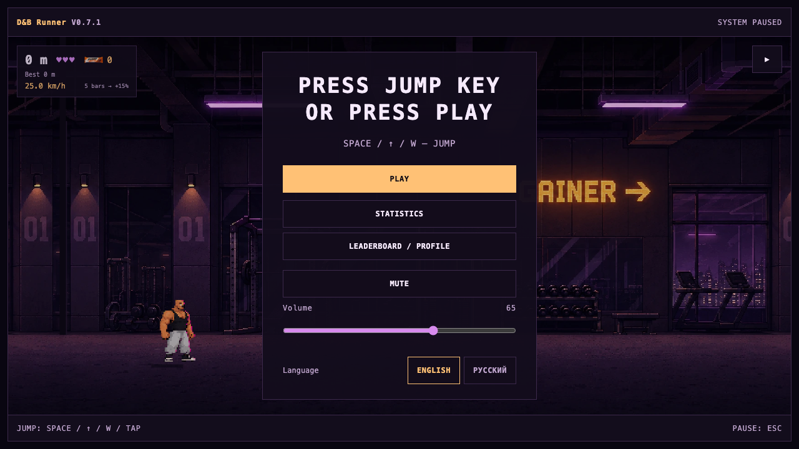
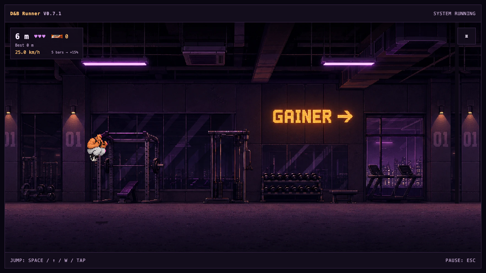

# Drum & Bass Runner

Браузерный endless runner для коротких игровых сессий и экспериментов с Canvas. Игрок прыгает через препятствия в неоновом спортзале, собирает батончики Pump Bite и разгоняется по ходу забега.





## Возможности

- Canvas 2D с логической сценой 640 × 360, равномерным масштабированием и поддержкой экранов с разными пропорциями.
- Прыжки с клавиатуры (`Space`, `↑`, `W`) и касанием; пауза, продолжение, новая игра, три жизни и прогрессия скорости.
- Последовательности препятствий, собираемые батончики, визуальная обратная связь и счёт забега.
- История личных результатов с сортировкой по дистанции, времени, предметам и скорости.
- Английская и русская локализация, клавиатурное управление, ARIA-метки и адаптивный интерфейс.
- По желанию: гостевой профиль, opt-in лидерборд и публичная ссылка-снимок забега. Данные API хранятся в локальной SQLite базе.
- Музыка меню и забега; блокировка autoplay или отсутствие аудиофайла не мешают игре.

## Моя часть проекта

В истории проекта мои изменения охватывают frontend/game architecture: игровой цикл и состояния забега, Canvas-сцены, прыжковую физику, ввод, обработку препятствий, аудиопланирование и меню. Курс рассчитывается в мировых координатах; столкновения и сбор предметов учитывают перемещение между кадрами. История забегов хранится отдельно от отображения, а сортировка не меняет сохранённый порядок. Online-клиент и HTTP/SQLite API разделены; профиль и участие в публичном рейтинге требуют отдельных действий пользователя. Я также развивал тестовое покрытие логики курса, ввода и lifecycle, статистики, локализации, online UI/client и серверных HTTP/SQLite сценариев.

## Стек и решения

Vite, строгий TypeScript, нативный Canvas 2D, обычные HTML/CSS и встроенный Node.js SQLite API. Фреймворки и игровой движок не используются. API необязателен для самой игры и локальной статистики.

## Запуск

Требуется Node.js 24 или новее.

```sh
npm ci
npm run dev
```

Откройте локальный адрес Vite. Команда запускает клиент и локальный API; локальная SQLite база создаётся в `data/online.sqlite` и исключена из Git.

Production-сборка и локальный запуск собранной версии:

```sh
npm run build
npm start
```

## Проверки

Проверено 29 октября 2026 года на Node.js 24.18.0:

- `npm ci` — успешно.
- `npm test` — успешно, 147 тестов.
- `npm run build` — успешно.
- `npm audit` — 0 уязвимостей после совместимого обновления Vite до 6.4.5.

`npm test` также собирает сервер перед запуском тестов. Браузерная проверка локального меню и игрового процесса зафиксировала прыжок и отсутствие ошибок страницы/консоли.

## Онлайн-демо и различия

[Играть в онлайн-демо](https://dbr.adavid.ru/).

В этой копии есть клиент, HTTP/SQLite API и связанные тесты, но нет production-конфигурации, резервного копирования и эксплуатационных инструкций. Online-функции работают локально против локального API; они не подключают к демо-базе данных. Участие в рейтинге добровольное. Как и в любой клиентской игре, сам браузер не является доверенной средой: защита очков от подмены не равна проверке на стороне авторитетного сервера.

## Права на медиа

Автор подтвердил 29 октября 2026 года права на графику и музыку, включённые в эту копию, и разрешил публикацию в публичном репозитории. Открытая лицензия на повторное использование кода или медиа не предоставлена.
